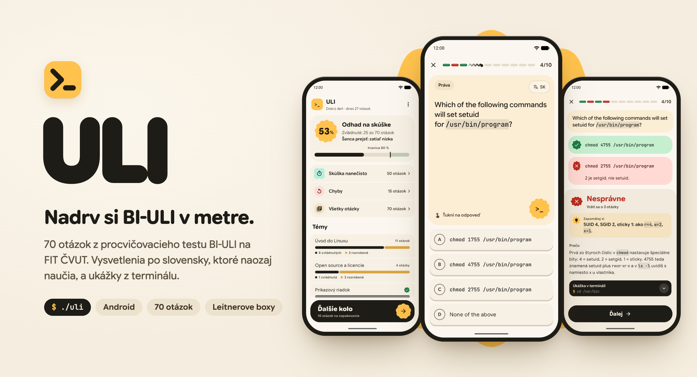
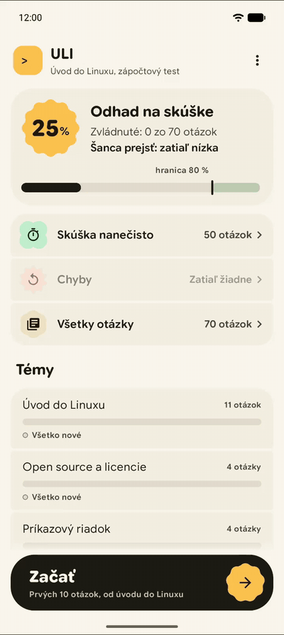
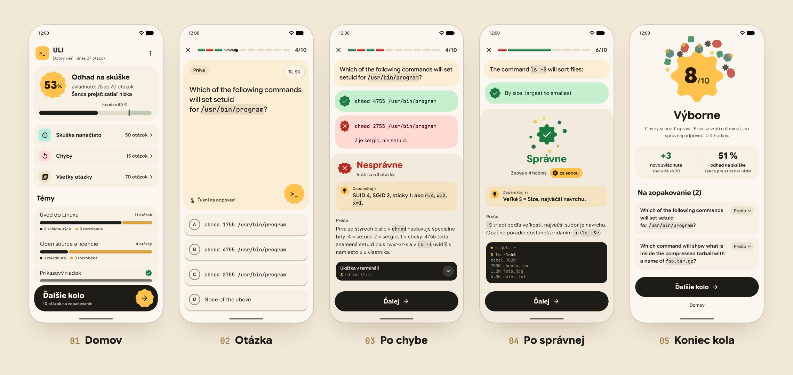
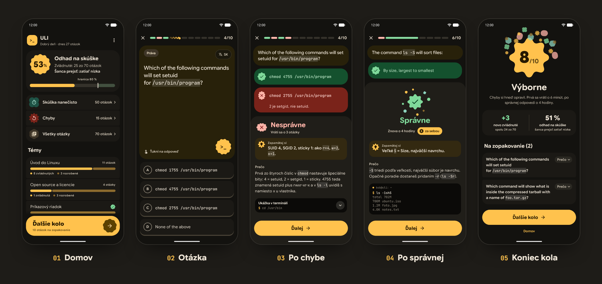

<p align="center">
  
</p>

<p align="center">
  <a href="https://github.com/teoobarca/bi-uli/releases/latest/download/ULI.apk"><b>⬇ Stiahnuť ULI.apk</b></a>
  &nbsp;·&nbsp; Android 13+ &nbsp;·&nbsp; offline &nbsp;·&nbsp; zadarmo
</p>

**ULI** je Android appka na precvičenie zápočtového testu **BI-ULI (Úvod do Linuxu)** na FIT ČVUT. Obsahuje všetkých
70 otázok z procvičovacieho testu, ktorý študenti zdieľajú na fit-wiki. Pri každej otázke sa dozvieš, prečo je
odpoveď správna a prečo tá tvoja nebola. Kolo má 10 otázok, takže ho stihneš cestou v metre.

Celá appka vznikla z jedného promptu v [Claude Code](https://claude.com/claude-code) a [T3 Code](https://t3.codes). Máš iPhone?
[Takto si ju prenesieš](#časté-otázky).

## Inštalácia (2 minúty)

1. V mobile otvor [**ULI.apk**](https://github.com/teoobarca/bi-uli/releases/latest/download/ULI.apk) a stiahni ho.
2. Ťukni na stiahnutý súbor. Android sa spýta, či môže prehliadač inštalovať aplikácie, daj **Povoliť**.
3. **Inštalovať**. Hotovo, ďalej appka nepotrebuje internet.

Novšiu verziu nainštaluješ rovnako, cez tú starú. Tvoj postup ostane.

<table>
<tr>
<td width="300"></td>
<td>

### Čo vie

- **Kolá po 10 otázkach.** Na odpoveď stačí jeden ťuk, možnosti máš dole pod palcom.
- **Spätná väzba, ktorá učí.** Dozvieš sa, prečo je odpoveď správna, prečo je tvoja voľba zlá, dostaneš pomôcku
  na zapamätanie a ukážku z terminálu.
- **Chyby sa vracajú.** Otázka, ktorú pokazíš, príde znova o 3 otázky. Potom o pár minút, o pár hodín a o pár dní,
  kým ju nevieš naisto (Leitnerove boxy).
- **Skúška nanečisto.** 50 náhodných otázok bez nápovedy a so stopkami, výsledok v bodoch ako na ostrom teste.
- **Úprimný odhad.** Domov ukáže, koľko by si mal na skúške a akú máš šancu prejsť. Po zlej odpovedi odhad nikdy
  nestúpne.
- **Otázky ostávajú po anglicky**, presne ako na teste. Tlačidlo SK ukáže slovenský preklad.

</td>
</tr>
</table>

## Zápočtový test v kocke

| | |
|---|---|
| Otázky | 50 náhodných zo všetkých kapitol kurzu, po anglicky |
| Body | 1,6 b za otázku, spolu 80 b |
| Na zápočet | **aspoň 64 b** (80 %), t. j. najviac 10 chýb |
| Pomôcky | žiadne, ani papier a pero |
| Kde | počítačová učebňa FIT, termíny v KOS-e, so sebou preukaz |

Zdroj: [fit-wiki BI-ULI](https://fit-wiki.cz/%C5%A1kola/p%C5%99edm%C4%9Bty/bi-uli). Podľa nej ostrý test vyzerá presne
ako procvičovací test, len má 50 otázok namiesto 70.

> **Pozor:** nie je overené, že na ostrom teste budú len týchto 70 otázok. Test berie otázky zo všetkých kapitol
> kurzu Linux Essentials a ich banka je väčšia: zo ~200 otázok, ktoré študenti zozbierali na fit-wiki
> ([vypracované testy](https://fit-wiki.cz/%C5%A1kola/p%C5%99edm%C4%9Bty/bi-uli/materialy)), je v týchto 70 len 23.
> Appka ťa naučí témy, na ktoré sa test pýta, ale „Odhad na skúške“ a „Šanca prejsť“ počítajú len s týmito 70
> otázkami.

## Pozor na týchto 9 otázok

Test sa hodnotí podľa kľúča Cisco/NDG, ktorý sa miestami nezhoduje so skutočným Linuxom. Appka učí odpoveď podľa
kľúča, lebo za ňu dostaneš body, a pri týchto otázkach ťa na rozdiel upozorní.

| # | Kľúč chce | V praxi |
|---|---|---|
| 6 | Windows nemá „Linux compatibility mode“ | Windows 10/11 má WSL |
| 7 | Interpretované jazyky „majú viac funkcií“ | Všeobecne to neplatí |
| 33 | `tar -tzf foo.tar.gz` | GNU tar zvládne aj `tar -tf` (kompresiu rozpozná sám) |
| 41 | `test $USERS -eq 5` | Pri hodnote 5 prejde aj `test $USERS = 5` (porovná reťazce) |
| 44 | GPT: `sgdisk`, `gdisk`, `cgdisk` | Aj novší `sfdisk` už vie GPT |
| 45 | `ps` ukáže len procesy aktuálneho shellu: True | Presnejšie: procesy s tvojím EUID na tom istom termináli |
| 51 | `service network restart` „vypne rozhrania, znova načíta konfiguráciu…“ | Aj „zastaví a znova spustí“ je pravda |
| 54 | Tradičný UNIX: 16 skupín | Závisí od verzie (V7 mal 1 aktívnu, BSD 16) |
| 59 | `groupmod` nepridáva používateľov: False | shadow-utils 4.11+ má `groupmod -a -U` |

## Obrazovky

<p align="center"></p>

<details>
<summary>Tmavý režim</summary>
<p align="center"></p>
</details>

## Časté otázky

**Je aj pre iPhone?** Zatiaľ nie, len Android 13 a novší. Celá appka však vznikla z jedného promptu v
[Claude Code](https://claude.com/claude-code) a [T3 Code](https://t3.codes), takže port na iPhone si spravíš rovnako.
Naklonuj repo, otvor ho v Claude Code (alebo v T3 Code) a daj mu tento prompt:

```text
Preportuj túto appku na iPhone.
```

Keď ti port pôjde, pošli pull request alebo link a pridám ho sem.

**Potrebuje internet?** Nie. Appka nemá ani povolenie na internet, tvoj postup ostáva len v mobile.

**Android hlási „neznámy zdroj“ alebo Play Protect.** Je to bežné pri appkách mimo Google Play. Celý zdrojový kód je
tu v repe, APK si môžeš zostaviť aj sám (pozri nižšie).

**Našiel som chybu v otázke alebo vo vysvetlení.** Založ [issue](https://github.com/teoobarca/bi-uli/issues) alebo
uprav [`content/questions.json`](content/questions.json) a pošli pull request. Každá otázka je jeden objekt
s textom, možnosťami, vysvetlením a ukážkou.

<details>
<summary><b>Pre vývojárov</b></summary>

Kotlin, Jetpack Compose, Material 3. Žiadny server ani analytika.

- `content/questions.json`: 70 otázok, zdroj pravdy. `python3 content/check.py` ho skontroluje.
- `app/src/main/java/dev/hamper/uli/engine/`: učenie bez Androidu (Leitnerove boxy, kolá, skúška, odhad), pokryté
  unit testami.
- Postup je v `progress.json`, rozrobené kolo alebo skúška v `session.json`. Oba sa zapisujú atomicky. Poškodený
  súbor sa nezmaže, appka ho odloží bokom.

```sh
scripts/gate.sh                  # testy + debug build + kontrola obsahu
scripts/capture.sh <dir>         # zábery všetkých obrazoviek v oboch témach (beží na emulátore)
./gradlew :app:assembleRelease   # potrebuje podpisový kľúč v ~/.uli/android-signing.properties
```

Potrebuješ JDK 21 a Android SDK (compileSdk 37). Debug build (`./gradlew :app:installDebug`) kľúč nepotrebuje.

</details>

## Licencia

Neoficiálny študentský projekt, nemá nič spoločné s ČVUT, FIT ani Cisco. Texty otázok a odpovedí patria
Cisco Networking Academy / NDG (kurz Linux Essentials) a pochádzajú z procvičovacieho testu, ktorý študenti
zdieľajú na fit-wiki. Vysvetlenia, preklady a kód sú pod licenciou [MIT](LICENSE). Fonty Google Sans Flex
a JetBrains Mono sú pod licenciou [OFL](licenses/).
